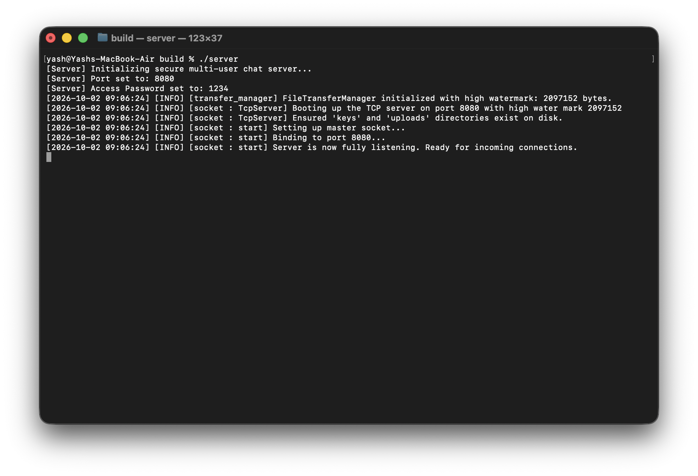
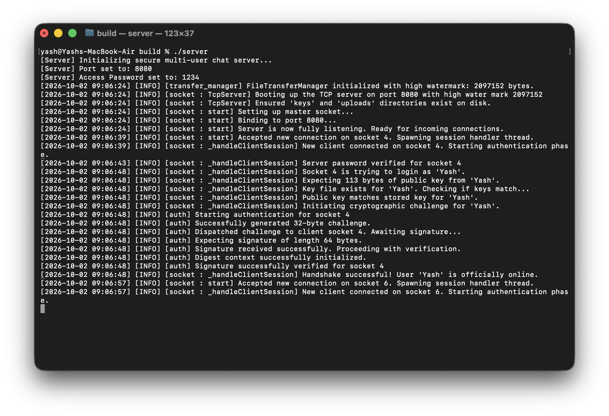
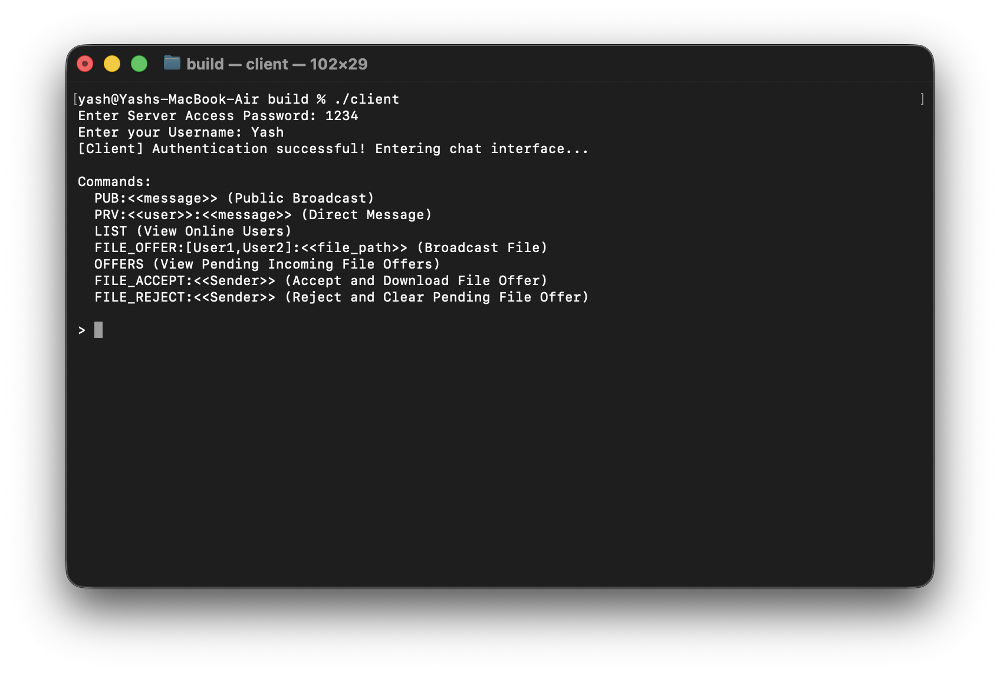
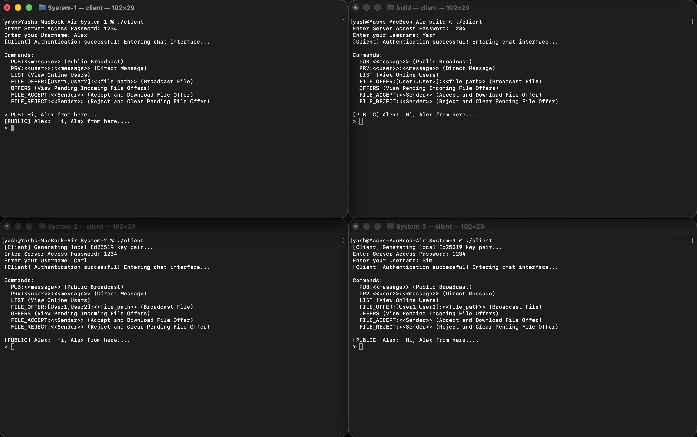
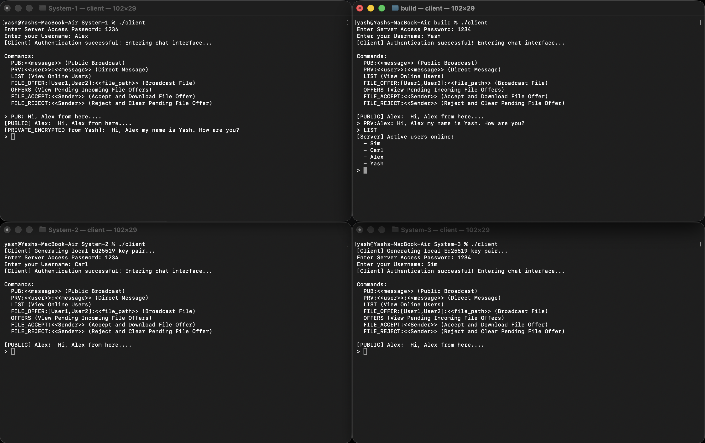
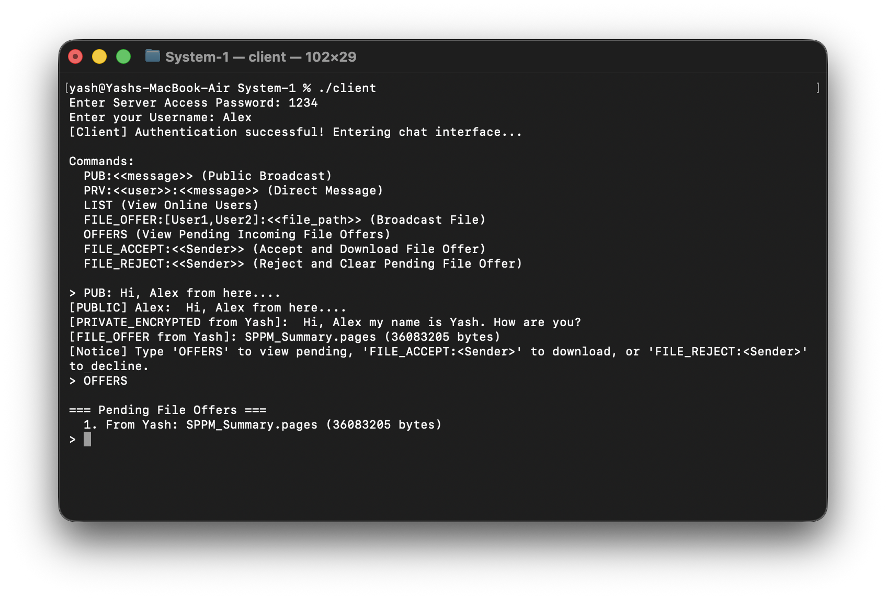
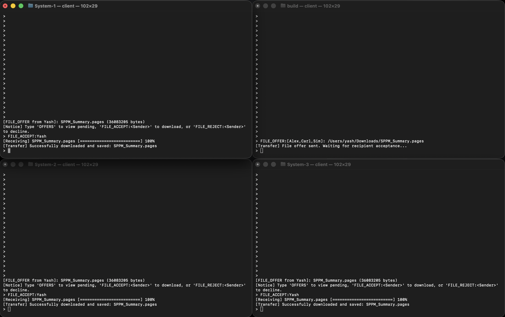

# CRAA: Cryptographic Relay & Asset Archiver

Welcome to **CRAA**! It is a highly secure, multi-threaded C++ terminal chat and file transfer app.

I basically built this because I wanted a lightweight, zero-distraction enviroment to chat and sling massive files across the local network without relying on third-party cloud. It’s entirely terminal based, handles its own cryptographic handshakes, and use some network backpressure stuff so nobody's RAM gets overwhelmed when someone try to send a huge file.

## Visual Tour & Working

### 1. The Server (Backend)

The server acts as the main secure relay for all clients.

* When booted, the server bind to port `8080` by defualt. I also hardcoded a high watermark of 2097152 bytes (2MB) in transfer manager to throttle heavy traffic. This is so the server don't crash if some client is downloading too slow and buffer gets full.
* It actively log incoming connections and manages the authentication phase (generating challenge and verify client signature).



* Once handshake is success, user is officially online. You can see full logs tracking this below.



### 2. The Client Interface

The client is designed super minimal and strictly command-line.

* On launching, client require the server access password and your unique username.
* Once you are inside, a list of commands is displayed. You can broadcast, DM, or manage files from there.



### 3. Chatting (Public & Private)

The chat handle multiple streams of data same time seamlessly.

* You can send public broadcast (e.g., `PUB: Hi, Alex from here....`), which instantly appear on everyone screen.



* You can also send encrypted direct messages. These are explicitly tagged as `[PRIVATE_ENCRYPTED]` on the receiver side so you know it is a DM. If you forgot who is online, just use `LIST` command and server print active users.



### 4. File Transfers (Resilient)

This part took alot of time. We don't just dump bytes in socket and hope for best; it uses offer/accept protocol. I did this so you don't randomly get a massive file forced onto your machine without you asking for it.

* User can offer a file to specific recipients. It triggers a `[FILE_OFFER]` notification on their screens with file name and exact byte size.
* Recipients can type `OFFERS` to view numbered list of pending incoming files waiting for them.



* When you accept the file (e.g., `FILE_ACCEPT:Yash`), a live progress bar appear tracking download until 100%. The system comfortably handles large files by processing it cleanly through a 64KB chunk buffer loop.



## Installation & Compilation

Because this project relys heavily on POSIX sockets and OpenSSL, compilation process vary depending on your OS.

### Dependancies

You will need **C++17**, **CMake (3.14+)**, and **OpenSSL**.

**Linux (Ubuntu/Debian)**
```bash
sudo apt update
sudo apt install build-essential cmake libssl-dev
```

**macOS (via Homebrew)**
```bash
brew install cmake openssl
```

**Windows**
Because the networking code uses `<sys/socket.h>` and other POSIX headers, it will *not* compile natively on Windows using MSVC. Windows sockets are a pain, so you must use **WSL (Windows Subsystem for Linux)**.

Open PowerShell and run:
```bash
wsl --install
```

Restart machine, open your new Ubuntu terminal, and follow the **Linux** instructions above.

### Building the Executables

Clone repository, then create a build directory. You can compile in Release or Debug mode.

> **Note:** Debug mode leaves all my verbose socket logging on. It is great if you want to see exactly how chunks move, but it make the server terminal very noisy.

```bash
mkdir build && cd build

# For Debug Mode 
cmake .. -DCMAKE_BUILD_TYPE=Debug

# For Release Mode (Silent, optimised for actual use)
cmake .. -DCMAKE_BUILD_TYPE=Release

cmake --build .
```

## Usage Guide

Once compiled, you'll have `server` and `client` binary in the build folder.

### Starting the Server

You need to run server first so clients actually have somewhere to connect.

```bash
# Starts on defualt port 8080 with defualt password "1234"
./server

# Start with a custom password and port if you want more secure
./server MySecurePass -p 9090
```

### Starting the Client

Open a seperate terminal window (or multiple windows, if you want to test by talking to yourself).

```bash
./client
```

The programme will ask you for server password, then your username. If it’s first time logging in, it will generate an Ed25519 key pair locally in your folder. **Keep these `.pem` files safe.** If you delete or lose private key, server will reject you next time you try to log in with same username because signatures won't match anymore.

### Chat Commands

Type these directly into prompt while client is running:

* **Public Broadcast:** `PUB:Hello everyone in the lobby!`
* **Private DM:** `PRV:Alice: Hey Alice, did you get that document?`
* **List Users:** `LIST`

### File Transfer Commands

Files handled sequentially so terminal output doesn't become mess.

* **Offer a File:** Send offer to one or multiple users. Path can be absolute or relative.
  `FILE_OFFER:[Alice,Bob]:/home/user/documents/massive_video.mp4`

* **View Pending Offers:** Check what people try to send you.
  `OFFERS`

* **Accept a File:** Start downloading file from a sender offer.
  `FILE_ACCEPT:Alice`

* **Reject a File:** Clear it from queue if you don't want or already downloaded.
  `FILE_REJECT:Alice`